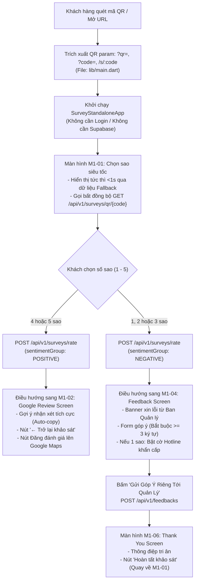

# BÁO CÁO PHÂN TÍCH MÃ NGUỒN VÀ KIẾN TRÚC KIỂM THỬ (ANALYSIS REPORT)

- **Mã nhiệm vụ Jira:** SCRUM-189
- **Tên User Story:** [E1.1] Kiểm thử chức năng và giao diện khảo sát QR
- **Phân hệ:** Review Funnel – Khảo sát QR (<1s) & Giao diện trên thiết bị di động Android
- **Nền tảng kiểm thử thực tế:** Samsung Galaxy A07, Android 16
- **Ngày lập:** 06/11/2026
- **Người thực hiện:** QA Engineer / Automation Test Engineer
- **Phiên bản mã nguồn:** CX-SHIELD v0.1.0+1 (Flutter 3.x, Spring Boot 4.0.0, Java 21)

---

## 1. Mục tiêu và Phạm vi Phân tích

Báo cáo này phân tích kiến trúc mã nguồn frontend Flutter và các API backend liên quan của hệ thống CX-SHIELD phục vụ việc kiểm thử giao diện và chức năng luồng khảo sát cảm xúc QR trên điện thoại Android thật.

### Phạm vi phân tích bắt buộc của SCRUM-189:
1. Mở khảo sát QR không cần đăng nhập.
2. Nhận diện cơ sở, chi nhánh và số bàn.
3. Luồng chọn đánh giá từ 1 đến 5 sao.
4. Điều hướng theo mức đánh giá (Tích cực: 4–5 sao vs Tiêu cực: 1–3 sao).
5. Validation nội dung góp ý trên form M1-04.
6. Gửi phản hồi góp ý và xác nhận Backend tiếp nhận thành công.
7. Cơ chế xử lý khi Backend hoặc mạng không hoạt động (Offline Fallback).
8. Trải nghiệm tải màn hình tức thì (< 1s).
9. Cơ chế và hiện tượng điều hướng Back (Lỗi đóng băng trên Android 16).

> [!NOTE]
> Các chức năng thuộc Epic E1.4 (Lối đi đánh giá công khai Google Maps chống review gating) và Epic E6/E9 (Màn hình nhận Voucher M2-01) nằm ngoài phạm vi nghiệm thu trực tiếp của SCRUM-189, được ghi nhận độc lập và không tính vào chỉ số hoàn thành của nhiệm vụ này.

---

## 2. Kiến trúc Luồng Hoạt động Frontend và Tương tác Backend

### 2.1. Sơ đồ luồng hoạt động tổng thể


### 2.2. Điểm kích hoạt ứng dụng độc lập (Standalone Entry Point)
Tại `frontend/lib/main.dart` (dòng 16–44):
- Ứng dụng kiểm tra tham số URL: nếu có query parameter `qr` hoặc `code`, hoặc đường dẫn `/s/:code`, biến `hasQrParam` được đặt là `true`.
- Khi `!AppConfig.isConfigured || hasQrParam`, ứng dụng khởi chạy thẳng `SurveyStandaloneApp(qrCode: qrCode)` bỏ qua hoàn toàn bước đăng nhập và khởi tạo Supabase, đảm bảo hiển thị tức thì cho khách hàng vãng lai tại bàn.

---

## 3. Danh mục File và Chức năng Chi tiết

| Thành phần | Đường dẫn tệp tin | Chức năng kỹ thuật chính |
| :--- | :--- | :--- |
| **Màn hình M1-01** | `frontend/lib/screens/m1_01_rating_screen.dart` | Khảo sát cảm xúc ban đầu. Hiển thị thương hiệu, chi nhánh, số bàn, 5 icon sao đổi màu và emoji động (1–5 sao), cờ loading `_isSubmitting`, nút gọi khẩn cấp tại bàn. |
| **Màn hình M1-02** | `frontend/lib/screens/m1_02_google_review_screen.dart` | Giao diện cảm ơn khách 4–5 sao. Khung gợi ý nhận xét có nút sao chép Clipboard, nút `← Trở lại khảo sát`, hộp thoại hướng dẫn mở Google Maps. |
| **Màn hình M1-04** | `frontend/lib/screens/m1_04_feedback_screen.dart` | Form góp ý riêng tư 1–3 sao. Banner xin lỗi, danh sách chủ đề góp ý, ô nhập nội dung (validate min 3 ký tự), ô SĐT Việt Nam, checkbox đồng ý liên hệ. |
| **Màn hình M1-05** | `frontend/lib/screens/m1_05_urgent_call_screen.dart` | Hỗ trợ khẩn cấp cho khách 1 sao. Hiển thị số hotline quản lý, nút bấm gọi ngay, form yêu cầu quản lý ra bàn hoặc gọi lại trong 5 phút. |
| **Màn hình M1-06** | `frontend/lib/screens/m1_06_thank_you_screen.dart` | Màn hình cảm ơn kết thúc khảo sát. Card quà tặng tri ân và nút hoàn tất quay lại từ đầu. |
| **Cấu hình API** | `frontend/lib/core/constants/api_constants.dart` | Đọc `BACKEND_URL` qua `String.fromEnvironment`, mặc định `http://localhost:8080/api/v1`, timeout 3000ms. |
| **Dịch vụ API** | `frontend/lib/core/services/survey_api_service.dart` | Gọi HTTP REST API và thực hiện fallback ngầm khi mất kết nối. |
| **Mô hình DTO** | `frontend/lib/core/models/` | `survey_init_model.dart`, `rate_result_model.dart`, `feedback_response_model.dart`. |
| **Cấu hình Android** | `frontend/android/app/src/` | `main/AndroidManifest.xml` (thiếu quyền Internet và cleartext), `debug/AndroidManifest.xml` (có quyền Internet). |

---

## 4. Phân tích Chi tiết Lỗi Điều hướng Back trên Samsung A07 (Android 16)

### 4.1. Hiện tượng thực tế ghi nhận
- Thiết bị thử nghiệm: Samsung Galaxy A07, hệ điều hành Android 16.
- Sau khi chọn đánh giá trên M1-01 và chuyển sang M1-02 hoặc M1-04:
  1. Nhấn nút Back in-app (`← Trở lại khảo sát` trên M1-02): Ứng dụng bị đứng hình, không phản hồi.
  2. Nhấn nút Back hoặc vuốt cử chỉ Back của Android: Ứng dụng cũng bị đứng, không quay lại M1-01.
  3. Hiện tượng xảy ra tương tự bất kể Backend bật hay tắt, và không làm sập (crash) ứng dụng ngay lập tức.

### 4.2. Điểm bất thường được phát hiện trong mã nguồn (Code Anomaly)
Qua rà soát mã nguồn, phát hiện **sự mâu thuẫn trong quản lý ngăn xếp điều hướng (Navigation Stack Inconsistency)** giữa M1-01 và M1-02:

1. **Tại `frontend/lib/screens/m1_01_rating_screen.dart` (dòng 79 và 88):**
   ```dart
   if (stars >= 4) {
     Navigator.of(context).pushReplacement(
       MaterialPageRoute(builder: (_) => M102GoogleReviewScreen(...)),
     );
   } else {
     Navigator.of(context).pushReplacement(
       MaterialPageRoute(builder: (_) => M104FeedbackScreen(...)),
     );
   }
   ```
   Lệnh `pushReplacement` đã **hủy bỏ và gỡ bỏ hoàn toàn `M101RatingScreen` khỏi ngăn xếp Navigator**, khiến màn hình tiếp theo (M1-02 hoặc M1-04) trở thành Route gốc duy nhất trong bộ nhớ (`Navigator.canPop(context) == false`).

2. **Tại `frontend/lib/screens/m1_02_google_review_screen.dart` (dòng 216–219):**
   ```dart
   // Nút quay lại khảo sát
   TextButton(
     onPressed: () => Navigator.of(context).pop(),
     child: const Text('← Trở lại khảo sát'),
   )
   ```
   Nút in-app lại gọi `Navigator.of(context).pop()`. Do ngăn xếp phía dưới đã rỗng (`canPop() == false`), hành vi này ném Assertion Error ngầm hoặc pop rỗng Navigator, khiến giao diện đứng yên hoặc đóng băng khung hình.

3. **Tương tác với Android 16 Predictive Back:**
   Android 16 gửi sự kiện `popRoute`. Khi Flutter phản hồi `canPop() == false` và không có `PopScope` can thiệp, cử chỉ back của hệ thống bị kẹt giữa OS và Flutter Activity.

4. **Trạng thái loading `_isSubmitting`:**
   Tại `M101RatingScreen`, cờ `_isSubmitting` được đặt thành `true` khi gửi đánh giá nhưng không có khối `finally` hoặc callback reset về `false` khi quay lại.

> [!WARNING]
> **Lưu ý kiểm thử:** Đây là điểm bất thường kỹ thuật được chỉ ra rõ ràng từ đối chiếu dòng code. Đội kiểm thử không tự ý sửa code sản phẩm mà ghi nhận lỗi chi tiết vào Bug Report để đội Developer thẩm tra và xử lý.

---

## 5. Rủi ro Kỹ thuật và Khuyến cáo cho Giai đoạn Thực thi

1. **Rủi ro Silent Fallback (Thành công giả lập):** Lớp `SurveyApiService` bọc toàn bộ gọi mạng bằng `catch (_)`. Khi backend mất kết nối, hệ thống tự động sinh `responseId` dạng `local-timestamp` và vẫn cho phép điều hướng bình thường trên điện thoại. Tester bắt buộc phải đối chiếu log Backend (Spring Boot console) để xác nhận dữ liệu có thực sự được lưu hay không.
2. **Yêu cầu kết nối qua USB ADB:** Do thiếu `android:usesCleartextTraffic="true"` trên Android 9+, tester bắt buộc phải dùng lệnh `adb reverse tcp:8080 tcp:8080` qua cáp USB để điện thoại gọi được `localhost:8080` mà không bị hệ điều hành chặn.

