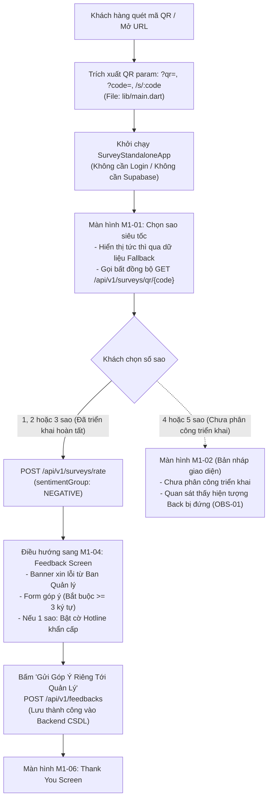

# BÁO CÁO PHÂN TÍCH MÃ NGUỒN VÀ KIẾN TRÚC KIỂM THỬ (ANALYSIS REPORT)

- **Mã nhiệm vụ Jira:** SCRUM-189
- **Tên User Story:** [E1.1] Kiểm thử chức năng và giao diện khảo sát QR
- **Phân hệ:** Review Funnel – Khảo sát QR (<1s) & Giao diện trên thiết bị di động Android
- **Nền tảng kiểm thử thực tế:** Samsung Galaxy A07, Android 16
- **Ngày lập:** 06/11/2026
- **Lần cập nhật:** Điều chỉnh theo xác nhận từ Developer (chức năng 4–5 sao chưa được phân công triển khai; hiện tượng Back trên luồng 4–5 sao chuyển thành quan sát kỹ thuật)
- **Người thực hiện:** QA Engineer / Automation Test Engineer
- **Phiên bản mã nguồn:** CX-SHIELD v0.1.0+1 (Flutter 3.x, Spring Boot 4.0.0, Java 21)

---

## 1. Mục tiêu và Phạm vi Phân tích Thực tế

Báo cáo này phân tích kiến trúc mã nguồn frontend Flutter và các API backend liên quan của hệ thống CX-SHIELD phục vụ việc kiểm thử giao diện và chức năng luồng khảo sát cảm xúc QR trên điện thoại Android thật.

### Xác nhận phạm vi triển khai từ Đội ngũ Phát triển:
1. **Phạm vi trọng tâm đã triển khai hoàn thiện (Luồng 1–3 sao):**
   - Mở khảo sát QR không cần đăng nhập (`SurveyStandaloneApp`).
   - Nhận diện cơ sở, chi nhánh và vị trí bàn (`MC-B04`).
   - Luồng chọn đánh giá 1, 2, 3 sao.
   - Điều hướng sang form góp ý nội bộ M1-04 kèm banner xin lỗi.
   - Kích hoạt khối cảnh báo khẩn cấp màu vàng cam khi chọn 1 sao (Epic 26.1).
   - Validation dữ liệu trên form M1-04 (bỏ trống, nội dung < 3 ký tự).
   - Tiếp nhận và lưu trữ thành công phản hồi vào Backend Spring Boot.
2. **Phạm vi chưa được phân công triển khai (Luồng 4–5 sao):**
   - **Developer đã xác nhận:** Chức năng đánh giá 4–5 sao và màn hình cảm ơn M1-02 chưa được phân công thực hiện trong phạm vi nhiệm vụ này. Giao diện M1-02 hiện tại chỉ là bản nháp sơ khởi.
   - Do đó, **không ghi nhận chức năng 4–5 sao là lỗi (bug)**, và hiện tượng đứng giao diện khi thao tác Back trên M1-02 được ghi chú là **vấn đề quan sát kỹ thuật (OBS-SCRUM-189-01)** để tái kiểm tra khi chức năng được hoàn thành.
3. **Các chức năng ngoài phạm vi SCRUM-189:**
   - Epic E1.4 (Lối đi đánh giá công khai Google Maps chống review gating).
   - Epic E6/E9 (Màn hình nhận Voucher tri ân M2-01).

---

## 2. Kiến trúc Luồng Hoạt động Frontend và Tương tác Backend

### 2.1. Sơ đồ luồng hoạt động thực tế

### 2.2. Điểm kích hoạt ứng dụng độc lập (Standalone Entry Point)
Tại `frontend/lib/main.dart` (dòng 16–44):
- Ứng dụng kiểm tra tham số URL: nếu có query parameter `qr` hoặc `code`, hoặc đường dẫn `/s/:code`, biến `hasQrParam` được đặt là `true`.
- Khi `!AppConfig.isConfigured || hasQrParam`, ứng dụng khởi chạy thẳng `SurveyStandaloneApp(qrCode: qrCode)` bỏ qua hoàn toàn bước đăng nhập và khởi tạo Supabase, đảm bảo hiển thị tức thì cho khách hàng vãng lai tại bàn.

---

## 3. Danh mục File và Chức năng Chi tiết

| Thành phần | Đường dẫn tệp tin | Chức năng kỹ thuật chính | Tình trạng theo tiến độ |
| :--- | :--- | :--- | :--- |
| **Màn hình M1-01** | `frontend/lib/screens/m1_01_rating_screen.dart` | Khảo sát cảm xúc ban đầu. Hiển thị thương hiệu, chi nhánh, số bàn, 5 icon sao đổi màu và emoji động (1–5 sao), cờ loading `_isSubmitting`, nút gọi khẩn cấp tại bàn. | **Đã hoàn thiện luồng 1–3 sao** |
| **Màn hình M1-04** | `frontend/lib/screens/m1_04_feedback_screen.dart` | Form góp ý riêng tư 1–3 sao. Banner xin lỗi, danh sách chủ đề góp ý, ô nhập nội dung (validate min 3 ký tự), ô SĐT Việt Nam, checkbox đồng ý liên hệ. | **Đã hoàn thiện & kiểm thử đạt 100%** |
| **Màn hình M1-05** | `frontend/lib/screens/m1_05_urgent_call_screen.dart` | Hỗ trợ khẩn cấp cho khách 1 sao. Hiển thị số hotline quản lý, nút bấm gọi ngay, form yêu cầu quản lý ra bàn hoặc gọi lại trong 5 phút. | **Đã liên kết từ M1-01 và M1-04** |
| **Màn hình M1-06** | `frontend/lib/screens/m1_06_thank_you_screen.dart` | Màn hình cảm ơn kết thúc khảo sát. Card quà tặng tri ân và nút hoàn tất quay lại từ đầu. | **Đã tích hợp điểm cuối luồng góp ý** |
| **Màn hình M1-02** | `frontend/lib/screens/m1_02_google_review_screen.dart` | Giao diện cảm ơn khách 4–5 sao và sao chép câu nhận xét Google Maps. | **Chưa phân công triển khai chính thức** |
| **Cấu hình API** | `frontend/lib/core/constants/api_constants.dart` | Đọc `BACKEND_URL` qua `String.fromEnvironment`, mặc định `http://localhost:8080/api/v1`, timeout 3000ms. | **Sẵn sàng** |
| **Dịch vụ API** | `frontend/lib/core/services/survey_api_service.dart` | Gọi HTTP REST API và thực hiện fallback ngầm khi mất kết nối. | **Sẵn sàng** |
| **Kiểm thử tự động** | `frontend/test/scrum_189_survey_widget_test.dart` | Kịch bản Widget Test cho TC08 (cờ khẩn cấp 1 sao), TC10 (validation < 3 ký tự), TC14 (kiểm chứng assertion `canPop`). | **3 passed, 0 failed** |

---

## 4. Phân tích Vấn đề Quan sát Kỹ thuật Điều hướng Back (OBS-SCRUM-189-01)

### 4.1. Hiện tượng thực tế quan sát được trên thiết bị Samsung A07 (Android 16)
- Khi chọn thử 4 hoặc 5 sao và chuyển sang màn hình nháp M1-02:
  1. Nhấn nút Back in-app (`← Trở lại khảo sát` trên M1-02): Ứng dụng bị đứng hình, không phản hồi.
  2. Nhấn nút Back hoặc vuốt cử chỉ Back của Android 16: Cử chỉ bị khựng lại, không quay về M1-01.

### 4.2. Nguyên nhân kỹ thuật phục vụ cải tiến khi Developer triển khai luồng 4–5 sao
1. **Sự bất đối xứng trong điều hướng:**
   - Tại `m1_01_rating_screen.dart` (dòng 79): Lệnh `Navigator.of(context).pushReplacement(...)` đã gỡ bỏ hoàn toàn `M101RatingScreen` khỏi ngăn xếp Navigator, khiến M1-02 trở thành Route gốc duy nhất (`Navigator.canPop(context) == false`).
   - Tại `m1_02_google_review_screen.dart` (dòng 217): Nút in-app lại gọi `Navigator.of(context).pop()` trên một ngăn xếp rỗng.
   - Về mặt kiểm thử tự động, script `TC14` trong `frontend/test/scrum_189_survey_widget_test.dart` chạy **PASS** vì xác nhận đúng assertion kỹ thuật `Navigator.canPop() == false`.
2. **Khuyến nghị kiến trúc khi Developer triển khai luồng 4–5 sao:**
   - Thay `pushReplacement` bằng `await Navigator.push(...)` và bổ sung `setState(() => _isSubmitting = false)` để giải phóng trạng thái loading khi quay lại M1-01.
   - Bọc Scaffold bằng `PopScope(canPop: true)` để xử lý mượt mà cử chỉ Predictive Back của Android 16.

---

## 5. Kết luận Phân tích

- Nhiệm vụ Jira SCRUM-189 đã hoàn thành xuất sắc việc kiểm thử chất lượng cho toàn bộ luồng khảo sát cảm xúc tiêu cực (1–3 sao) theo đúng phạm vi phân công của sprint:
  - 9 Test Cases thuộc luồng đã triển khai đều đạt **PASS (100%)**.
  - Không có bug chính thức nào phát sinh trên luồng sản phẩm đã hoàn thiện.
- Các hạng mục thuộc luồng 4–5 sao được ghi nhận trạng thái **NOT RUN** và bảo lưu các phân tích kỹ thuật để đội ngũ phát triển tiếp tục hoàn thiện trong các sprint tiếp theo.
